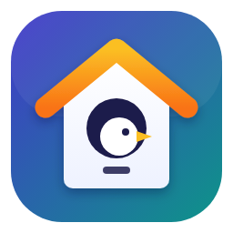
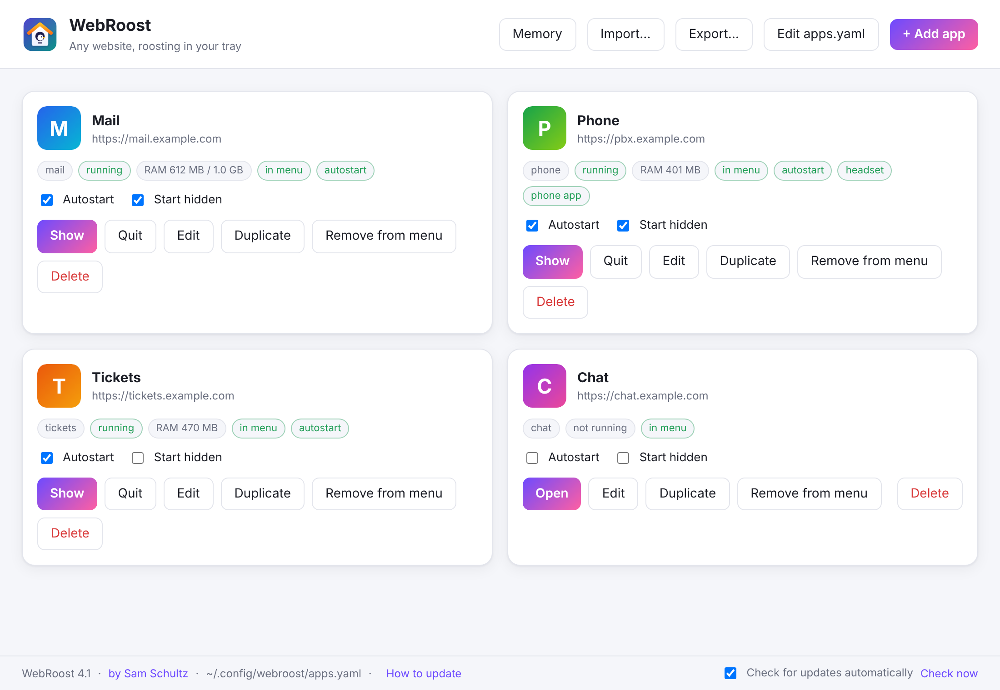
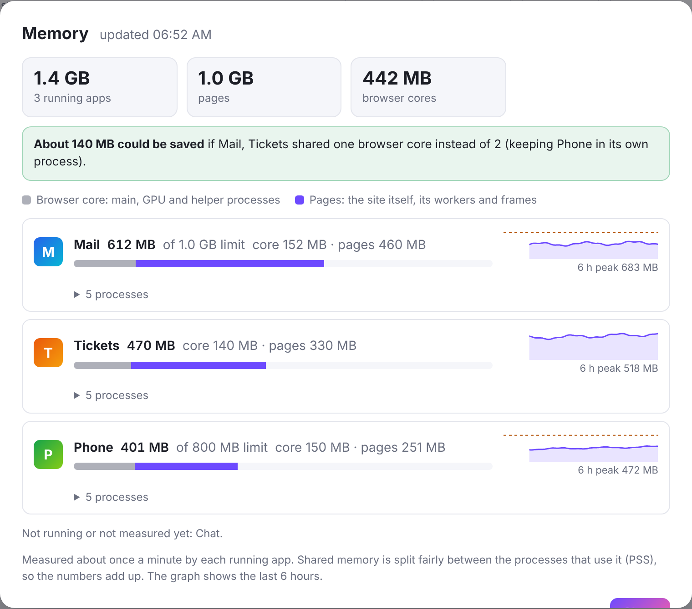

<p align="center"></p>

<h1 align="center">WebRoost</h1>

<p align="center"><b>Any website, roosting in your tray.</b><br>
Run Outlook, a web softphone, your ticketing system, Claude, or any other site as its own
desktop app: own window, tray icon, login, notifications, unread badge, autostart and headset buttons.</p>

<p align="center">
  <a href="https://github.com/samschultzponsys/webroost/releases/latest"><b>Download</b></a> ·
  <a href="CHANGELOG.md">Changelog</a> ·
  <a href="#install">Install</a> ·
  <a href="#moving-from-pwa-pop">Moving from PWA Pop</a> ·
  <a href="TESTING.md">Test checklist</a>
  <br>Current version: <b>4.9</b> · Linux (KDE Plasma, GNOME, XFCE, Cinnamon…) · X11 and Wayland
</p>

<p align="center"></p>

> **Formerly PWA Pop.** Same project with a new name, and now one name
> everywhere: the app, the `webroost` command and `~/.config/webroost`.
> Upgrading? See [Moving from PWA Pop](#moving-from-pwa-pop).

## Why WebRoost

Chrome's "installed web apps" on Linux are a pile of compromises: tabs that
die when the browser closes, notifications that never pop up, logins that
expire after every reboot, softphones that stop ringing when minimized. WebRoost
gives each site a real, always-on desktop app instead, built for **KDE Plasma 6
on Wayland** and working on any desktop with a system tray.

- **Each app is its own app.** Separate process, window, tray icon, taskbar
  entry, menu entry and login. Run two accounts of the same site side by side.
- **Notifications that actually show up.** Native desktop popups with the
  app's own name and icon. Clicking one opens the app. Outlook's new-mail
  popups show the sender, subject and preview.
- **Built for phones and headsets.** Calls keep ringing while hidden. USB
  headset buttons (WebHID) work out of the box, and `tel:`/`sip:` links from
  anywhere dial in your softphone.
- **Stays signed in.** Single sign-on and OIDC logins survive restarts,
  updates and reboots.
- **Lives in the tray.** Close or minimize to the tray, start hidden at login,
  and see unread counts on the tray icon and taskbar.
- **Keeps an eye on memory.** A per-app memory view, plus an optional limit
  that reloads an app gently (never mid-call).

## Features

| | |
|---|---|
| **Manager** | Paste any address. WebRoost reads the site's name, icon and start page, and can detect your headset. Edit, duplicate, export and import apps. |
| **Tray icon per app** | Left-click shows or hides the app. Right-click: Show/Hide, Reload, Send test notification, Mute, Save diagnostics…, Manage apps…, Quit. Unread count badge on the icon. |
| **Close and minimize to tray** | Close (and Ctrl+W) always hides to the tray, and minimize does too (on by default for new apps; on KDE Plasma via a small KWin script). Calls keep ringing in the tray. |
| **Always awake** | No background throttling, so calls ring and mail arrives while the app is hidden. |
| **Notifications** | Native popups via the desktop's notification service, labelled with each app's name and icon. Optional urgent mode for incoming calls; mute per app. |
| **New-mail popups** | *Notify when the unread count goes up*: for sites like the new Outlook, whose own notifications need Chrome's web push. |
| **Own login per app** | Separate browser profiles. Session cookies are kept for 14 days, so SSO logins survive restarts. |
| **Permissions** | Microphone, camera, notifications, clipboard and speaker selection are granted automatically, but **only** for the app's own sites. Everything else is denied. |
| **Headsets (WebHID)** | Your configured headset (e.g. Yealink WH64) is selected automatically, so answer, hang-up and mute buttons work. |
| **Click-to-call** | One app can be the default for `tel:`, `callto:` and `sip:` links. It fills in the number and presses Call. |
| **Links and sign-in** | The app and its sign-in pages (OIDC, SAML, Microsoft, Google…) stay inside; other links open in your browser. Pop-up windows such as a time entry open at a usable, remembered size. |
| **Memory** | A live per-app view with a 6-hour history, plus an optional memory limit: reload, then restart, but never during a call or while you type. |
| **Duplicates** | Second account on the same site: one click gives it its own login, a different icon colour and a label. |
| **Export / import** | Move all apps with settings and icons to another computer in one file. |
| **Updates** | Checks GitHub Releases, verifies every download against `SHA256SUMS.txt`, installs it (or gives you the exact command), then restarts everything onto the new version, waiting until you're not on a call. |
| **Diagnostics** | *Save diagnostics…* writes a text file with settings, notification and unread-count status and a recent log. No terminal needed. |

## Install

Download from the [latest release](https://github.com/samschultzponsys/webroost/releases/latest).
Every release has every format, with the version in the file name:

| Distro | File | Install |
|---|---|---|
| Any distro, sandboxed (**recommended**) | `webroost-<ver>-x86_64.flatpak` | `flatpak install --user ./webroost-<ver>-x86_64.flatpak` |
| Fedora, RHEL, Alma, openSUSE | `webroost-<ver>-x86_64.rpm` | `sudo dnf install ./webroost-<ver>-x86_64.rpm` |
| Debian, Ubuntu, Mint, Pop!_OS | `webroost-<ver>-amd64.deb` | `sudo apt install ./webroost-<ver>-amd64.deb` |
| Arch, Manjaro, EndeavourOS | `webroost-<ver>-x64.pacman` | `sudo pacman -U webroost-<ver>-x64.pacman` |
| Any distro, portable | `webroost-<ver>-x86_64.AppImage` | `chmod +x webroost-*.AppImage && ./webroost-*.AppImage` |
| Manual | `webroost-<ver>-x64.tar.gz` | Extract anywhere and run `./webroost` |

The rpm, deb and pacman packages install to `/opt/webroost` and add the
`webroost` command (plus `webtray`, the old name), a menu entry and the headset
udev rule.

**Headset with the Flatpak or AppImage?** Install the udev rule once, then
replug the headset (the native packages do this for you):

```bash
curl -LO https://raw.githubusercontent.com/samschultzponsys/webroost/main/build/70-webroost-hid.rules
```

```bash
sudo cp 70-webroost-hid.rules /usr/lib/udev/rules.d/ && sudo udevadm control --reload-rules && sudo udevadm trigger
```

> **Ubuntu 24.04+ and the AppImage:** Ubuntu blocks unprivileged user
> namespaces, so Chromium's sandbox won't start from an AppImage. Use the
> `.deb`, which ships an AppArmor profile, or run the AppImage with `--no-sandbox`.

## Quick start

1. Open **WebRoost** from your app menu (or run `webroost`).
2. Click **+ Add app**, paste an address such as `https://outlook.office.com/mail`
   and press **Fetch details**.
3. Pick the options you want (start at login, start hidden, notify on new mail,
   minimize to tray…) and **Save**.
4. The app gets its own menu entry. Start it, sign in, done.

Paste the site's **normal address**, not a Chrome "install" link. If the site
has a web app manifest, WebRoost reads its name, start page and icon. Otherwise it
picks up the site's icon after your first sign-in, or you can choose one.

### Settings worth knowing

In **Manage apps → Edit**:

- **Notify when the unread count goes up**: new-mail popups for the new Outlook
  and similar sites, with sender, subject and preview. Tick *Only pop up when
  the new message can be shown* to skip plain "New message" popups.
- **Minimize to the tray**: on by default for new apps. Minimize hides the app
  to its tray icon instead of the taskbar, and clicking the tray icon brings it
  back. On KDE Plasma (Wayland), WebRoost loads a small KWin script that takes
  the minimized window off the taskbar, because KWin doesn't tell apps they
  were minimized (the Flatpak asks once for permission to talk to KWin).
  Elsewhere on Wayland it's best effort.
- **Stay signed in across restarts**: on by default.
- **Open phone links (tel:, callto:, sip:)**: makes this app your click-to-call
  phone. See [Click-to-call](#click-to-call).
- **Memory limit**: e.g. 1500 MB. The app is reloaded, then restarted, when it
  goes over, but never during a call or while you're using it.

## Moving from PWA Pop

WebRoost is PWA Pop renamed. The Flatpak has a new ID, so it installs as a new
app next to the old one, once:

1. Install WebRoost (for the Flatpak, download `webroost-<ver>-x86_64.flatpak`
   from the [latest release](https://github.com/samschultzponsys/webroost/releases/latest)):

   ```bash
   cd ~/Downloads && flatpak install -y --user ./webroost-*-x86_64.flatpak
   ```

2. Quit your PWA Pop apps (tray icon → **Quit**) and open **WebRoost**. On
   first start it moves everything over automatically:
   - your apps, icons, window positions **and logins** (from `~/.config/webtray`);
   - the menu and autostart entries, so PWA Pop no longer starts at login;
   - the default app for phone links.

   A banner in the manager confirms what was brought over.
3. Remove PWA Pop (the banner has a Copy button for this):

   ```bash
   flatpak uninstall --user io.github.samschultzponsys.PwaPop
   ```

   The rpm, deb and pacman packages replace the old `pwa-pop` package
   automatically.
4. Once everything works, `~/.config/webtray` can be deleted. It contains a
   `MOVED-TO-WEBROOST.txt` note.

On a **different computer**, use **Export…** in PWA Pop or WebRoost and
**Import…** in WebRoost instead (see below). The `webtray` command,
`WEBTRAY_*` settings and `.pwapop` export files keep working.

## Memory

<p align="center"></p>

**Memory** in the manager's header (or any app's RAM badge) shows each running
app's memory, split into its **browser core** (main, GPU and helper processes)
and its **pages** (the site itself). It also shows a 6-hour graph with the
memory limit marked, the peak, and every process. Shared memory is split
fairly between the processes using it (PSS), so the numbers add up instead of
counting Chromium's libraries several times.

The view also estimates what the apps would save by sharing one browser core,
keeping the phone app in its own process.

## Click-to-call

Edit your softphone app (e.g. Linkus) and tick **Open phone links (tel:,
callto:, sip:)**. Clicking a phone number or call icon anywhere (a CRM,
ConnectWise, email, the browser) then opens the app and dials. If the number
appears but the call doesn't start, right-click inside the softphone:

1. **Use for click-to-call → Number field** on the dialpad's number box;
2. **Use for click-to-call → Call button** on the green call button;
3. **Test (fills in 123, does not call)** to check.

The menu only appears in the app that handles phone links.

## Moving to another computer

**Export…** in the manager saves every app, with its settings and icon, to one
`.webroost` file. On the other computer, install WebRoost and use **Import…**
(also on the empty start screen). The apps get their menu and autostart entries.
Logins don't travel in the file, so sign in to each app once.

## Several accounts on the same site

Every app has its own profile, so two entries for the same site are fully
separate: different logins, cookies and settings. To add a second account:

1. Click **Duplicate** on the app. The copy gets a unique ID and name
   ("Claude (2)"), a different icon colour and a numbered label, so the tray
   icons are easy to tell apart.
2. Optionally rename it (e.g. "Claude (Work)") and **Save**.
3. **Open** it and sign in with the other account.

Both run side by side, each with its own window, tray icon and taskbar entry.

## Updates

WebRoost checks GitHub Releases shortly after it starts and then every 12 hours,
and tells you once per new version with a notification, a tray menu item and a
banner in the manager.

| Installed as | Updating |
|---|---|
| AppImage, rpm, deb, pacman | **Install update** downloads the release, verifies it against `SHA256SUMS.txt` and installs it (with your password for system packages). Then every running app restarts onto it, waiting until you're not on a call. |
| Flatpak | **How to update** gives a one-line command that downloads, verifies and installs it, then restarts the apps; **Download** saves the verified file to `~/Downloads`. Installed from the Flatpak repository (if enabled), Discover and `flatpak update` handle it. |
| tar.gz | You're told about the release; download it yourself. |

**How to update** in the manager's footer shows the exact steps for your
install, including a copyable one-line command that downloads, verifies and
installs the right package. For the Flatpak it looks like this; set `V` to the
version you want:

```bash
V=4.9; cd ~/Downloads && curl -fL -o webroost-$V-x86_64.flatpak https://github.com/samschultzponsys/webroost/releases/download/v$V/webroost-$V-x86_64.flatpak && curl -fsSL https://github.com/samschultzponsys/webroost/releases/download/v$V/SHA256SUMS.txt | grep " webroost-$V-x86_64.flatpak$" | sha256sum -c - && flatpak install -y --user ./webroost-$V-x86_64.flatpak && flatpak run --branch=stable io.github.samschultzponsys.WebRoost --restart-all
```

## Troubleshooting

* **Notifications reach the history but don't pop up (KDE).** KDE Plasma
  doesn't pop up notifications sent by an app's own processes, so WebRoost
  sends them through a small helper (since 3.7). If they still don't pop up,
  check Do Not Disturb: KDE turns it on by itself while a full-screen app is
  focused or screens are mirrored. `WEBROOST_NOTIFY=electron` switches back to
  Electron's own notifications.
* **Minimize still goes to the taskbar.** Check *Minimize to the tray* is ticked
  for that app. On KDE, the app's **Save diagnostics…** log says whether the
  KWin script loaded.
* **No popup for new mail (Outlook).** Tick *Notify when the unread count goes
  up*. Use the tray's **Send test notification** to check popups in general.
* **Something's off?** Right-click the app's tray icon → **Save diagnostics…**.
  It writes `~/Downloads/webroost-<id>-diagnostics.txt` with settings,
  notification status, where the unread count comes from and a recent log, but
  no message contents. Attach it to an issue.
* **Sign-in opens in the browser.** The sign-in site isn't in
  `allowed_origins`. The diagnostics list every `redirect outside allowed_origins`.
* **No tray icon on GNOME.** Install the *AppIndicator and KStatusNotifierItem
  Support* extension. KDE, XFCE, Cinnamon and others work out of the box.
* **Headset not detected.** `getfacl /dev/hidraw*` should list your user. If
  not, install the udev rule ([Install](#install)) and replug.
* **"Couldn't sign you in … this browser or app may not be secure" (Google).**
  Google blocks sign-in from embedded browsers; since 4.9 WebRoost presents
  itself as Firefox on Google's sign-in pages only, which gets past it. If
  Google changes its check, sign in to the site another way (e.g. Claude's
  *Continue with email*).
* **A site says the browser is unsupported.** Set `user_agent:` to a current
  Chrome user agent string.
* **Known limits of Electron apps:** passkeys through your phone or a password
  manager, and DRM-protected streaming (Netflix, Spotify…), don't work. Use a
  password, an email code or a hardware security key instead of a passkey.
* **Start an app fresh.** Quit it, then `rm -rf ~/.config/webroost/profiles/<id>`.

## Configuration file

Everything lives in **`~/.config/webroost/apps.yaml`**. The manager edits it
for you and keeps your comments, and running apps pick up changes within a few
seconds. A full, commented example is in [`examples/apps.yaml`](examples/apps.yaml).

```yaml
- id: linkus
  name: Linkus
  url: https://pbx.example.com/
  start_hidden: true
  autostart: true
  allowed_origins: ["https://pbx.example.com"]
  hid_devices: [{ vendorId: 0x6993 }]   # auto-select Yealink WH64
  handle_schemes: [tel, callto, sip]    # click-to-call
  urgent_notifications: true
- id: outlook
  name: Outlook
  url: https://outlook.office.com/mail
  allowed_origins: ["https://outlook.office.com", "https://*.office.com", "https://login.microsoftonline.com"]
  notify_on_unread: true
  minimize_to_tray: true
  memory_limit_mb: 1500
```

<details>
<summary><b>All settings</b></summary>

| Key | Default | Meaning |
|---|---|---|
| `id` | required | Lowercase letters, digits, `-`, `_`. Used for `--app`, the profile folder and the desktop entry. |
| `name` | id | Display name. |
| `url` | required | Start page. |
| `icon` | `icons/<id>.png`, then the site's icon | PNG or SVG. |
| `start_hidden` | `false` | Start in the tray. |
| `autostart` | `false` | Start at login (hidden). |
| `allowed_origins` | origin of `url` | Sites that stay in-app and get permissions automatically. `https://*.example.com` matches subdomains; ports count. |
| `hid_devices` | `[]` | Headsets to select automatically: `[{ vendorId: 0x…, productId: 0x… }]` (`productId` optional). |
| `extra_permissions` | `[]` | More Chromium permissions, e.g. `display-capture`, `geolocation`. |
| `urgent_notifications` | `false` | Notifications stay on screen until dismissed. |
| `raise_on_notification` | `false` | Show the window when the page posts a notification. |
| `notify_on_unread` | `false` | Popup when the unread count goes up (sender, subject and preview when the page lists them). |
| `notify_only_with_message` | `false` | With `notify_on_unread`: no popup when the new message can't be found in the page (no plain "New message" popups). |
| `notify_show_unread_total` | `false` | With `notify_on_unread`: add the unread total to the popup. |
| `badge_regex` | `\((\d+)\)` | How to read an unread count from the page title. |
| `minimize_to_tray` | `false` (`true` for apps added in the manager or with `--add`) | Minimize hides to the tray. On KDE Plasma a KWin script takes the minimized window off the taskbar; on other Wayland desktops it's best effort (WebRoost notices the page being hidden). `WEBROOST_XWAYLAND=1` runs such apps under XWayland instead, where minimizing is always reported, but drawing can fail on some systems. |
| `forget_session_cookies` | `false` | Drop session cookies when the app closes, instead of keeping sign-ins for 14 days. |
| `memory_limit_mb` | – | Reload, then restart, the app above this many MB. Never during calls or while you're using it. |
| `handle_schemes` | – | Link types this app opens and dials, e.g. `[tel, callto, sip]`. Only one app has them at a time. |
| `dial_input`, `dial_button`, `dial_open` | – | Click-to-call targets, set from the softphone's right-click menu. |
| `pass_shortcuts` | `false` | Send every key combination to the page (remote desktop tools, web terminals) instead of handling Ctrl+W/R, F5, F12, Alt+←/→ and zoom. |
| `reload_on_resume` | `false` | Reload after suspend (re-registers softphones). |
| `ignore_certificate_errors` | `false` | Accept self-signed certificates, on allowed origins only. |
| `user_agent` | Chrome | Override the user agent. |
| `width`, `height` | 1200×800 | Initial window size. |
| `icon_color` | – | Recolour the icon: `blue`, `green`, `purple`, `orange`, `teal`, `pink`, `red`, `yellow`. |
| `icon_label` | – | 1–2 characters in a chip on the icon's corner. |
| `icon_auto` | – | Set by the manager: swap in the site's own icon after you sign in. |

Other files under `~/.config/webroost/`: `icons/`, `state/<id>.json` (window
position, mute, memory history) and `profiles/<id>/` (cookies, logins and
storage; delete it to sign out completely).

</details>

## Command line

```
webroost                          Open the manager
webroost --app <id> [--hidden]    Run app <id> (--hidden: start in the tray)
webroost --add <url> [--id x] [--name "X"] [--autostart] [--start-hidden]
webroost --install <id>           Add the app's menu entry (and autostart entry if autostart: true)
webroost --uninstall <id>         Remove both entries
webroost --list                   Show configured apps and what is installed
webroost --restart-all            Restart running apps (they wait until you're not on a call)
webroost --check-update           Check for a newer WebRoost and print how to update
webroost --update                 Download, verify and install it
webroost --version
```

For the Flatpak, run these as `flatpak run io.github.samschultzponsys.WebRoost …`.
`WEBROOST_DEBUG=1` prints the debug log to the terminal (it is always in
*Save diagnostics…*).

## How it works

```
webroost --app outlook
  └─ Electron main process (src/main.ts)
       ├─ profile ~/.config/webroost/profiles/outlook  → own login, single-instance lock
       ├─ desktop id …WebRoost.outlook                  → own taskbar icon, badge, menu entry
       └─ AppRuntime (src/runtime.ts)
            ├─ session: permissions, WebHID, downloads, sign-in flow, kept cookies
            ├─ window (no throttling; close and minimize to tray)
            │    └─ preload: Notification, badge and visibility shims (src/preload/)
            ├─ unread count: badge API, title, folder list → new-mail popups
            ├─ notification helper (src/notify-helper.ts, via the Flatpak portal)
            └─ tray icon (StatusNotifierItem) with unread badge
```

## Build from source

Requires Node.js 20+ (and `rpmbuild` for rpm packages).

```bash
git clone https://github.com/samschultzponsys/webroost && cd webroost && npm ci
```

```bash
npm start
```

That runs the manager from source. One app from source:

```bash
npm run build && npx electron . --app claude
```

All packages (into `release/`):

```bash
npm run dist
```

Flatpak (after `npm run dist`; needs `flatpak-builder`):

```bash
cd flatpak && flatpak-builder --user --install-deps-from=flathub --force-clean --repo=repo build-dir io.github.samschultzponsys.WebRoost.yml
```

Unit tests: `npm test`. Manual release checks: [TESTING.md](TESTING.md).

## Versioning and releases

* Versions are **`MAJOR.MINOR`**: … 4.8, 4.9, then **5.0**. `package.json`
  stores `4.9.0` because npm needs three numbers.
* To release: add notes under `## [Unreleased]` in `CHANGELOG.md`, bump the
  version (`npm run version:bump`) and push to `main`. GitHub Actions builds
  every package only when the version changes, and publishes **one release**,
  `v<version>`, with all of them and `SHA256SUMS.txt`.
* Optional: enable **Settings → Pages → Source: GitHub Actions** to publish a
  Flatpak repository at `https://samschultzponsys.github.io/webroost/`, so
  Flatpak installs from it update through Discover and `flatpak update`.

## License

WebRoost is free and open source under the [Apache License 2.0](LICENSE):
use it, change it, share it or build on it, commercially too. If you
distribute WebRoost or something based on it, include the [`NOTICE`](NOTICE)
file, which credits the original project, and mark the files you changed.
Releases up to 4.2 were published under the MIT License.

### Name and logo

"WebRoost" and the birdhouse logo identify this project. Forks and modified
versions are welcome, but please give them a different name and icon so
nobody mistakes them for the original, and keep the credit from `NOTICE`.

Created by **Sam Schultz**.
